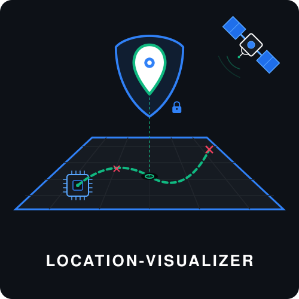

# location-visualizer

A lightweight geographic information system (GIS) for collecting, managing, processing and visualizing location and activity data on your own infrastructure. Deployments range from local, single-user installations to large-scale systems serving multiple users and distributed data sources.

Location data can be imported and exported in a variety of formats, including OpenGeoDB, CSV (RFC 4180), GPX and Records JSON (e. g. from Google Takeout). It is stored efficiently in a local database using the OpenGeoDB binary data format. Locations can be cleansed through operations like sorting and duplicate removal, and annotated with metadata such as timestamps, body weight, distances travelled, step counts, and energy expenditure. The resulting data can be explored on an interactive map, which supports mouse and scroll wheel navigation on computers and touch input on mobile devices, and exported for further analysis.

In addition to processing existing datasets, *location-visualizer* supports streaming live data from sensors deployed in the field and from other applications using token-based authentication. It integrates with external map services, particularly OpenStreetMap, and provides a web-based user interface alongside a native command-line client for remote administration and automated workflows.

The application supports multiple users with fine-grained permissions and challenge-response authentication using passwords and / or public-key cryptography.

## Building the software

To download and build the software from source for your system, run the following commands in a shell.

```bash
cd ~/go/src/
go get -d github.com/andrepxx/location-visualizer
cd github.com/andrepxx/location-visualizer/
make keys
make
```

This will create an RSA key pair for the TLS connection between the user-interface and the actual data processing backend (`make keys`) and then build the software for your system (`make`). The resulting executable is called `locviz`.

Default paths or file storage locations:

- Configuration data: `config/config.json`
- User account data: `data/userdb.json`
- Location data: `data/locations.geodb`
- Activity data: `data/activitydb.json`
- Map data / tiles: `data/tile.bin` and `data/tile.idx`

## User account setup

*location-visualizer* is a scalable, high-performance software solution that not only supports private, single-user scenarios, but also larger, enterprise-grade deployments. Therefore, besides supporting state-of-the-art cryptography, like TLS 1.3 in combination with RSA, ECDH over Curve25519, ChaCha20 and Poly1305, it also features strong, challenge-response based user authentication (password-based or public-key based) and secure storage of passwords as salted hashes. The public-key user authentication is based on RSA-PSS.

Therefore, before the software can be used, at least one user account has to be created. Then, set a password and add permissions to fetch tiles, render data overlays, read and write activity data, read from and write to the geographical database, as well as download its contents.

**HINT:** These commands are to be executed in a shell when the server does **not** run. Initial user management is "offline", since there are no users who'd have the right to carry out authenticated tasks. "Offline" user management is also useful for disaster recovery. If you want, you can enable "online" user management for certain users by giving them the `admin` permission. "Online" user management is work-in-progress though. Currently, only read operations are supported for "online" user management.

```bash
./locviz create-user root
./locviz set-password root secret
./locviz add-permission root get-tile
./locviz add-permission root render
./locviz add-permission root activity-read
./locviz add-permission root activity-write
./locviz add-permission root geodb-read
./locviz add-permission root geodb-write
./locviz add-permission root geodb-download
```

Optionally, if you want to allow clearing the geographical database, you can also add a permission for that.

```bash
./locviz add-permission root geodb-clear
```

And if you want to allow remote administration of the server through this account, add the `admin` permission.

```bash
./locviz add-permission root admin
```

Finally, run the server.

```bash
./locviz
```

After the following message appears in your console ...

```
Web interface ready: https://localhost:8443/
```

... point your web browser to <https://localhost:8443/> to fire up the web interface and interact with the visualization.

Log in with the user name and password defined above, in our example, these were `root` and `secret`, respectively.

Commands:

- `add-permission name permission`: Add the permission `permission` to the user `name`.
- `add-public-key name description path/key_file.pem`: Add the public key stored in `path/key_file.pem` to the user `name` with description `description`. (Hint: Put quotes around the description.)
- `cleanup-tiles`: Perform a cleanup of the tile database.
- `clear-password name`: Set the password of user `name` to an empty string.
- `create-device-token name description`: Create a new device token associated with user `name` and description `description`. (Hint: Put quotes around the description.)
- `create-user name`: Create a new user `name`.
- `export-tiles path/file.tar.gz`: Export map tiles from tile database to `path/file.tar.gz`.
- `has-device-token name token`: Check if user `name` has device token `token` associated.
- `has-permission name permission`: Check if user `name` has permission `permission`.
- `import-tiles path/file.tar.gz`: Import map tiles to tile database from `path/file.tar.gz`.
- `list-device-tokens name`: List all device tokens associated with user `name`, along with their creation time and an optional description.
- `list-permissions name`: List all permissions of user `name`.
- `list-public-keys name`: List all public keys of user `name`.
- `list-users`: List all users.
- `remote command host port certificate_file_path name password_or_key_file_path [...]`: Perform `command` on remote host `host` : `port`. Verify the server's certificate against `certificate_file_path` and authenticate as user `name` using either a password or an RSA private key `password_or_key_file_path`. (See command-line client section below.)
- `remove-device-token name token`: Remove the device token `token` from user `name`.
- `remove-permission name permission`: Remove the permission `permission` from the user `name`.
- `remove-public-key name index`: Remove the public key with index `index` (zero-based) from user `name`.
- `remove-user name`: Remove the user `name`.
- `set-password name password`: Set the password of user `name` to `password`.
- `show-public-key name index`: Output the public key with index `index` (zero-based) from user `name` in PEM representation.

## Integration with a map service like OpenStreetMap

This software can use data from sources of map data, like the OpenStreetMap project (OSM), to plot location data overlaid on an actual map. However, OpenStreetMap is a free service running on donated ressources and access to the map data may be rather slow for "third-party" users (i. e. everything but the "official" openstreetmap.org map viewer) at times. When OSM integration is enabled on both server and client side, the application may become slow / unresponsive until a significant amount of data has been replicated to the server's local cache. In addition, we do not want to place an unnecessary burden on OSM servers. Therefore, OSM integration is disabled via the configuration file when you download this software and has to be enabled explicitly if desired.

To enable integration with a map service, open the `config/config.json` file and replace the entry `"UseMap": false,` with `"UseMap": true,`. Then enter the URL of the map server to use, making use of the placeholders `${z}`, `${x}` and `${y}` for zoom level, X and Y coordinate of the map tile, respectively.

Therefore, a URL might look like the following: `https://tile.example.com/${z}/${x}/${y}.png`

Replace `tile.example.com` with the domain name (or IP address) of the actual tile server you want to use. This can be a public tile-server or one that you self-host. If you use a public tile server, please **pay close attention** to the provider's tile usage policy.

When enabled, note that response from the server may be **very** slow until a significant amount of map data has been cached locally. Map data stored in the cache never expires and can therefore become outdated. A proper cache update mechanism is not implemented yet. Also note that there is no bound up to which the cache will grow. **All** data fetched from OSM **will** be cached by the server indefinitely, in order to minimize the load on the map provider's infrastructure.

The tile cache is stored in binary files that use a proprietary (*location-visualizer* specific) file format. However, an interface is provided to import map tiles from or export map tiles to *Gzip*-compressed tarballs (`.tar.gz` files). To import data from a directory, you will have to archive it. The directory inside the archive **needs** to have the name `tile/` for the import to succeed. If you still have a "legacy" cache directory (from *location-visualizer* versions before v1.8.0), and you did not change the file naming conventions, you can archive the directory (the directory itself, **not** just the files within it) and import the result.

### Pre-fetching data from a map service

Pre-fetching of map data was more relevant in the past, when OSM heavily throttled third-party applications and *location-visualizer*'s tile handling wasn't as efficient as it is now and we generally don't recommend it anymore, in order not to cause unnecessary load on the map provider's infrastructure.

If you still want to prefetch map data, we suggest to pre-fetch map data up to a zoom level of 7 or 8.

```bash
./locviz -prefetch 7
```

If you want to pre-fetch zoom levels beyond 8, you will have to additionally specify the `-hard` option in order to confirm that you are aware that you are placing a significant load on the map provider's infrastructure, that the pre-fetch will take a long time and will use a lot of disk space (perhaps even more than you might have available on your system, potentially rendering it unstable).

### Importing and exporting map data

If you use *location-visualizer* v1.8.0 or newer, map tiles are stored in a binary database that consists of two files, normally residing under `data/tile.bin` and `data/tile.idx`, respectively. These two files always belong together, so backup, restore, delete, ... them always together. You can export the contents of the tile database to an archive using the `export-tiles` command, and import tiles from an archive into the database using the `import-tiles` command.

To reclaim storage occupied by outdated (unreferenced) images, you can run the `cleanup-tiles` command.

## Uploading geo data

To upload geo data to the geo database using the web UI, log in with a user account, which has at least `geodb-read` and `geodb-write` permissions. Open the sidebar, click on the *GeoDB* button, then choose the import and sort strategies from the dropdown. Afterwards, open a file explorer on your system and move the CSV, GPX or JSON files via drag and drop into the browser window. An import report will be displayed after the data has been imported.

Upload of geo data is also possible via the CLI client. Refer to the section below for more details.

## Interaction via command-line client

Starting from version v1.11.0, *location-visualizer* also implements a command-line client. It is accessed via the command `./locviz remote [...]`. Each command expects further parameters. The first five parameters (`host`, `port`, `certificate_file_path`, `name`, `password_or_key_file_path`) are required for connection and session establishment and are common to all commands. Some commands require a password and some (the ones with "-pk" suffix) require the path to an RSA key file instead.

The following commands are currently supported for ingestion and extraction of data:

- `export-activity-csv host port certificate_file_path name password output_file_path`: Export activity CSV data to path `output_file_path`. (File must not exist!)
- `export-activity-csv-pk host port certificate_file_path name key_file_path output_file_path`: Export activity CSV data to path `output_file_path`. (File must not exist!)
- `export-geodata host port certificate_file_path name password format output_file_path`: Export data from the geographical database to path `output_file_path`. (File must not exist!) Use format `format`, which may be any of `opengeodb`, `csv`, `json`, `json-pretty`, `gpx` or `gpx-pretty`.
- `export-geodata-pk host port certificate_file_path name key_file_path format output_file_path`: Export data from the geographical database to path `output_file_path`. (File must not exist!) Use format `format`, which may be any of `opengeodb`, `csv`, `json`, `json-pretty`, `gpx` or `gpx-pretty`.
- `import-geodata host port certificate_file_path name password format strategy input_file_path`: Import data into the geographical database from path `input_file_path`. Use format `format`, which may be any of `opengeodb`, `csv`, `json` or `gpx`, and import strategy `strategy`, which may be any of `all`, `newer` or `none`.
- `import-geodata-pk host port certificate_file_path name key_file_path format strategy input_file_path`: Import data into the geographical database from path `input_file_path`. Use format `format`, which may be any of `opengeodb`, `csv`, `json` or `gpx`, and import strategy `strategy`, which may be any of `all`, `newer` or `none`.

In addition, the following commands are currently supported for administrative tasks:

- `admin-has-device-token host port certificate_file_path name password target_user device_token`: Checks whether user `target_user` has the device token `device_token` attached. The boolean result gets written to `stdout`. In case an error occurs, it is reported to `stderr`.
- `admin-has-device-token-pk host port certificate_file_path name key_file_path target_user device_token`: Checks whether user `target_user` has the device token `device_token` attached. The boolean result gets written to `stdout`. In case an error occurs, it is reported to `stderr`.
- `admin-has-permission host port certificate_file_path name password target_user device_token`: Checks whether user `target_user` has the permission `permission`. The boolean result gets written to `stdout`. In case an error occurs, it is reported to `stderr`.
- `admin-has-permission-pk host port certificate_file_path name key_file_path target_user device_token`: Checks whether user `target_user` has the permission `permission`. The boolean result gets written to `stdout`. In case an error occurs, it is reported to `stderr`.
- `admin-list-device-tokens host port certificate_file_path name password target_user`: Returns a list of device tokens of user `target_user` with each token on a separate line. Each line contains the token itself in hexadecimal representation, its creation time in RFC3339 representation, as well as its description. The list gets written to `stdout`. In case an error occurs, it is reported to `stderr`.
- `admin-list-device-tokens-pk host port certificate_file_path name key_file_path target_user`: Returns a list of device tokens of user `target_user` with each token on a separate line. Each line contains the token itself in hexadecimal representation, its creation time in RFC3339 representation, as well as its description. The list gets written to `stdout`. In case an error occurs, it is reported to `stderr`.
- `admin-list-permissions host port certificate_file_path name password target_user`: Returns a list of permissions of user `target_user` with each permission on a separate line. The list gets written to `stdout`. In case an error occurs, it is reported to `stderr`.
- `admin-list-permissions-pk host port certificate_file_path name key_file_path target_user`: Returns a list of permissions of user `target_user` with each permission on a separate line. The list gets written to `stdout`. In case an error occurs, it is reported to `stderr`.
- `admin-list-public-keys host port certificate_file_path name password target_user`: Returns a list of public keys of user `target_user` with each public key on a separate line. Each line starts with the index of the public key, followed by a colon. It then contains the time the public key was associated with the user account in RFC3999 representation, the key type in brackets, the Base64 representation of the SHA-512 hash of the raw ASN.1 key material, and finally the description for the key. The list gets written to `stdout`. In case an error occurs, it is reported to `stderr`.
- `admin-list-public-keys-pk host port certificate_file_path name key_file_path target_user`: Returns a list of public keys of user `target_user` with each public key on a separate line. Each line starts with the index of the public key, followed by a colon. It then contains the time the public key was associated with the user account in RFC3999 representation, the key type in brackets, the Base64 representation of the SHA-512 hash of the raw ASN.1 key material, and finally the description for the key. The list gets written to `stdout`. In case an error occurs, it is reported to `stderr`.
- `admin-list-users host port certificate_file_path name password`: Returns a list of the names of all users with each user on a separate line. The list gets written to `stdout`. In case an error occurs, it is reported to `stderr`.
- `admin-list-users-pk host port certificate_file_path name key_file_path`: Returns a list of the names of all users with each user on a separate line. The list gets written to `stdout`. In case an error occurs, it is reported to `stderr`.
- `admin-show-public-key host port certificate_file_path name password target_user index`: Output the public key with index `index` (zero-based) from user `target_user` in PEM representation.
- `admin-show-public-key-pk host port certificate_file_path name key_file_path target_user index`: Output the public key with index `index` (zero-based) from user `target_user` in PEM representation.

The certificate file provided must be in PEM format. The certificate chain that the server provides is verified to match **exactly** against the one provided in the certificate file.

The RSA key file for user authentication, if required, must be in PEM format and store an RSA private key, either following the `PKCS#1` or the `PKCS#8` standard.

## Clearing the geo database

To clear the database, you can terminate the application and delete the database file storing the geo data. (This will by default reside under `data/locations.geodb`.) An empty database will be created on next startup of the application.

The database can also be cleared from within the web interface if the respective account performing the action has the required permission. For that, a SHA-512 hash of the database contents (in OpenGeoDB representation) has to be provided. This serves as proof that the person deciding to clear the database has downloaded a backup copy before and serves to prevent accidental deletion of data. You can prevent users from clearing the database by not giving them the required permission.

## Exchanging data with location-visualizer

Please refer to our [documentation of data formats](doc/data-formats.md) if you want to exchange location and / or activity data with *location-visualizer*.

If you want to implement a client interfacing with *location-visualizer*, for example for continuously uploading coordinate data, then, in addition to the data format specification referenced above, please also refer to the [protocol specification](doc/communications-protocol.md). Note that the *location-visualizer* project already provides implementations for both a web-based UI client (supplied by the server) and a command-line client.

## Integrating third-party applications and IoT devices

To provision a new third-party application or IoT device for an existing user account for submission of coordinate data, run the following command.

```bash
./locviz create-device-token root "Some description for the device"
```

Replace `root` by the name of the user you want to provision the third-party application or device to. A device can only submit data as long as the user it is associated with / provisioned for has the `geodb-write` permission.

This will return a device token in hexadecimal encoding, which the IoT device or third-party app can then use to submit data to an instance of *location-visualizer* running on a publicly-accessible server.

Use the following endpoint to submit your data: `https://[hostname]:[port]/cgi-bin/locviz`

Use the HTTP method `POST`.

Use the following HTTP header: `Content-Type: application/x-www-form-urlencoded`

And the following HTTP body: `cgi=submit-coordinates&name=[your username]&devicetoken=[the device token]&time=[timestamp]&latitude=[latitude]&longitude=[longitude]`

For example, when provisioning the *mendhak/gpslogger* app, you can configure it as follows.

- URL: `https://[hostname]:[port]/cgi-bin/locviz`
- HTTP Body: `cgi=submit-coordinates&name=[your username]&devicetoken=[the device token]&time=%TIME&latitude=%LAT&longitude=%LON`
- HTTP Headers: `Content-Type: application/x-www-form-urlencoded`
- HTTP Method: `POST`

Replace all the placeholders in square brackets with the actual values for the host name, port, user account and device token.

You can provision as many devices (generate as many device tokens) for a user as you want.

You can list all device tokens currently associated with a user with the following command.

```bash
./locviz list-device-tokens root
```

This not only lists the tokens themselves (their hexadecimal values), but also the (UTC) time when they were generated and the description that was provided when they were generated.

In case a device token gets compromised or a sensor gets decommissioned, you can remove (or dissociate) it from its user again.

```bash
./locviz remove-device-token root [the device token]
```

The capability to capture live sensor data, in conjunction with its multi-user capabilities, strong authentication, fine-grained access control and support for a multitude of standardized formats (including GNSS wire formats), make *location-visualizer* suitable for professional (commercial or government) applications, which involve capturing live data from sensors deployed in the field. The ability to provision device tokens extends the capability to submit coordinate data to third-party devices or applications, which do not implement the more secure challenge-response based authentication methods and application protocol, allowing for easy integration of third-party sensors into your workflow. At the same time, access to these less secure types of sensors or applications is limited to submitting coordinates, keeping the collected data secure and the attack surface minimal.

## Public-key authentication

Since v1.13.0, *location-visualizer* supports authentication using public-key cryptography, as is known from tools like SSH, etc.

Public-key authentication generally provides greater security than password-based authentication and is recommended for use in machine-to-machine communication and automated contexts (e. g. automated maintenance tasks), but also for privileged (e. g. administrative) accounts.

To use public-key authentication, generation of a key pair is required. Usually, a unique key pair will be generated for each client, e. g. using OpenSSL.

```bash
openssl genrsa -out client-private.pem 4096
openssl rsa -in client-private.pem -pubout -out client-public.pem
```

This will generate an RSA key pair with a key strength of 4096 bits. The private key will be stored in `client-private.pem`, while the public key will be stored in `client-public.pem`.

The public key must be associated on the server side with a user account to be used for authentication, while the private key must be kept secret and is used by the client during authentication.

```bash
./locviz add-public-key root "Some description for the key" client-public.pem
```

The public key must be in *PKCS#1* or *PKIX* format.

Replace `root` with the name of your user and replace the description between the quotes with a custom description to help identify the key.

You can show a summary of the keys associated with your user.

```bash
./locviz list-public-keys root
```

(Again, replace `root` with the name of the user.)

Which will generate an output like this.

```
0: 2025-10-21T20:25:15Z [PUBLIC KEY] 6YhYG71fEiEdxLIKQa733M8VgGNvnFIbjf5aLTAP2BOuQpM2Jua37sjEYtocYFhhbOEY2Mdfdys7z8Eck369MA== Some description for the key
```

The leading `0:` is the index. If you have multiple keys associated with your account, they will display in individual lines with indices like `1:`, `2:`, etc.

The entry `2025-10-21T20:25:15Z` is the time stamp (in UTC) identifying the point in time when the key was added to the account.

The entry `[PUBLIC KEY]` is the key type. This will be `[RSA PUBLIC KEY]` for an RSA public key according to *PKCS#1* and `[PUBLIC KEY]` for a public key according to *PKIX*. As a side note, it would be `[RSA PRIVATE KEY]` for an RSA private key according to *PKCS#1* and `[PRIVATE KEY]` for a private key according to *PKCS#8*, however, private keys for **client** authentication should **not** be stored on the server side.

The long string `6YhYG71fEiEdxLIKQa733M8VgGNvnFIbjf5aLTAP2BOuQpM2Jua37sjEYtocYFhhbOEY2Mdfdys7z8Eck369MA==` is the SHA-512 hash of the binary (ASN.1 DER) key data and can be used to uniquely identify the key, for example to detect duplicates or reuse of the same key across accounts.

It is followed by the textual description, in this case `Some description for the key`.

You can display the full key in PEM format using the following command.

```bash
./locviz show-public-key root 0
```

Replace `root` with the name of the user and `0` with the index of the public key to be displayed.

To remove a public key, use the following command.

```bash
./locviz remove-public-key root 0
```

Replace `root` with the name of the user and `0` with the index of the public key to be removed.

You can use the *location-visualizer* CLI client to authenticate using public-key cryptography and carry out operations on the server. For example, to connect to `localhost:8443`, validate the server certificate against `keys/public.pem`, authenticate as user `root` using public-key cryptography using the RSA public key stored in `client-private.pem`, download the full contents of the geographical database in CSV format and save it to the file `output.csv`, use could use the following command.

```bash
./locviz remote export-geodata-pk localhost 8443 keys/public.pem root client-private.pem csv output.csv
```

The key stored in `client-private.pem` must be an RSA key in either `PKCS#1` or `PKCS#8` format.

*PKCS#1* is the older specification and is limited to RSA keys (both private and public keys), while *PKCS#8* is the more modern specification and can store different types of private keys, while *PKIX* can store different public-keys. Since *location-visualizer* uses RSA-PSS for user authentication, only RSA keys are supported and the client will exit with an error when a *PKCS#8* key for a different cryptosystem is supplied.

The key must **not** be encrypted.

## Q and A

Please refer to our extensive [Q and A section](doc/q-and-a.md), which covers more questions about *location-visualizer*, its history, developer, governance, data formats, etc.
